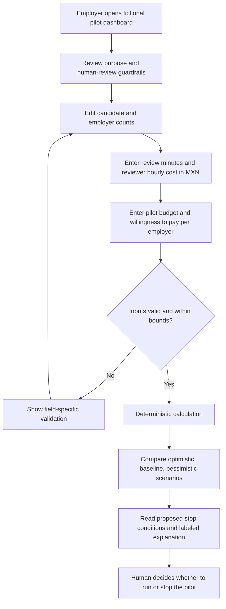
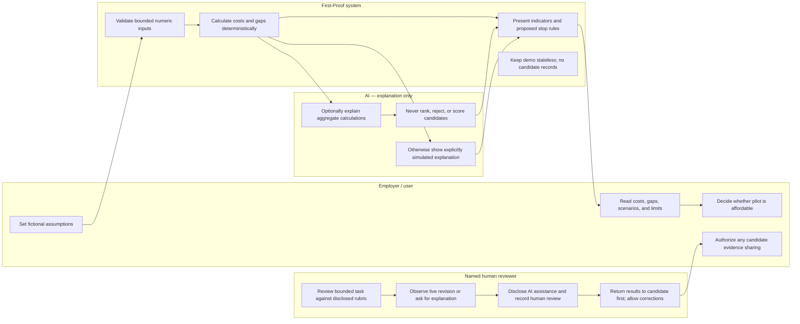

# FIRST-PROOF — PILOT ECONOMICS

**Assignment role:** MONEY — José Fernando Kuri Lois  
**Evidence status:** Fictional demo assumptions only. Proposed stop thresholds are not validated findings.

## 1. Problem statement

Mexican small businesses need a practical way to estimate human review time and budget when testing short, observed, skills-based candidate tasks. This calculator models review economics; it does not make or recommend hiring decisions.

## 2. Exact target user

A Mexican small-business owner or hiring manager with limited recruiting time and budget, considering a small skills-demonstration pilot and needing a quick estimate in MXN. The fictional cohort defaults to 12 candidates and 3 employers. No real employer or candidate data is used.

## 3. Success definition

The user can change candidate/employer counts, review minutes, reviewer hourly cost, total pilot budget, and per-employer willingness to pay; understand total and per-unit review costs and both budget gaps; compare three scenarios; and see feasibility indicators and proposed stop rules. Calculations are deterministic, transparent, and do not collect or retain personal information.

## 4. Image-generated UI mockup reference

The original illustrative vector mockup is [first-proof-pilot-economics-mockup.svg](first-proof-pilot-economics-mockup.svg). It is not a screenshot or an externally generated image; no image-generation output was provided or claimed. It depicts a responsive economics dashboard with editable assumptions, baseline estimate, scenario cards, and visible guardrails.

## 5. Product flow — Mermaid

## 6. Responsibility swimlane — Mermaid

## 7. Benchmark against skills-assessment solutions

Employer-designed work-sample platforms and virtual job simulations such as Forage demonstrate structured, role-related tasks; assessment vendors such as TestGorilla demonstrate standardized pre-employment assessments. This prototype makes no unsupported comparative outcome claims. Its hypothesis is a deliberately small, Mexico-oriented pilot economics view that exposes reviewer time and MXN costs while foregrounding candidate control and human review—not proprietary assessment science or proven better hiring.

## 8. Three-sentence long-term vision

First-Proof could help Mexican small businesses explore fairer ways to recognize practical skills without treating formal employment history as the only evidence. Candidates would control a portable record of bounded demonstrations, see and correct results first, and choose whether to share each item. Any future use would keep assessment task-specific, AI assistance disclosed, human-reviewed, compensated when productive work is involved, and separate from automated ranking or rejection.

## 9. Scope exclusions

- No CV builder, job board, applicant tracking system, or candidate marketplace.
- No universal employability score, candidate score, ranking, automated rejection, or hiring recommendation.
- No candidate fees; no unpaid productive client work.
- No real candidate/employer records, authentication, database, analytics, or persistence in this demo.
- No AI assessment of candidate evidence; AI may only explain aggregate calculations.
- No reuse of private submissions without candidate permission.
- No claim that feasibility, employer demand, stop thresholds, or hiring outcomes are validated.

## 10. Architecture and DRAGON STACK

| Layer | Choice | Responsibility / boundary |
|---|---|---|
| UI | Existing Next.js App Router, React, TypeScript, Tailwind CSS | Responsive accessible dashboard; preserve existing project. |
| Domain | Pure typed TypeScript calculations | Validate inputs and compute totals, unit costs, gaps, and scenarios. |
| Demo data | Fictional typed constants | Defaults: 12 candidates, 3 employers; never presented as research. |
| AI | Optional server-side explanation; simulated fallback | No browser/Git secrets; simulated output explicitly labeled; aggregate explanation only. |
| Persistence | None | No personal information storage or API keys exposed. |
| Hosting / repository | Existing Vercel project / GitHub remote | Free-tier deploy if account access and build permit; additive scoped commits. |
| **D — Demonstration** | Aggregate estimate and three scenarios | Explain costs without implying hiring validity. |
| **R — Role workflow** | Employer plans; named reviewer evaluates | Human reviewer accountable for every proof. |
| **A — AI assistance** | Aggregate explanation only | Disclose AI; label deterministic simulated fallback. |
| **G — Guardrails** | Candidate rights and human review | Bounded task, rubric, AI disclosure, live revision/explanation, named reviewer; candidate sees results first, corrects, exports, and authorizes sharing; unsuccessful attempts private. |
| **O — Outcome boundary** | Cost / affordability estimates only | No employment prediction, universal score, rank, or rejection. |
| **N — No real data** | Fictional values and in-memory state | No persistence without authentication and Row Level Security. |
| **S — Stop rules** | Proposed thresholds | Explicitly not validated findings. |
| **T — Task integrity** | Bounded skill demonstration | Real work needs agreed compensation, supervision, scope, acceptance rules, and applicable labor protections. |

## 11. Test plan

1. Build and load the existing app; inspect desktop and narrow mobile layouts.
2. Verify defaults: 12 × 10 minutes × $180/hour = $360 total, $30/candidate, $120/employer, and $140 budget remaining against $500.
3. Verify willingness total ($750) and gap (+$390) against the $360 baseline cost.
4. Change each input and check deterministic updates; test optimistic (0.75×), baseline (1×), and pessimistic (1.5×) review time.
5. Reject blank, non-numeric, negative, fractional where disallowed, and out-of-range values; ensure no NaN/Infinity.
6. Test budget and willingness-to-pay indicators separately; neither implies hiring value.
7. Verify stop rules and “proposed / not validated” labels.
8. Inspect fictional-data and simulated-AI disclosures; verify no personal-data fields, persistence, exposed secret, candidate ranking, or rejection.
9. Walk the actual UI as a skeptical, time-constrained small-business owner; record only observed usability issues and fix the most serious.
10. Run production build and deployment smoke check; report only tests and deployment actually completed.

## 12. Blueprint conditions and shadow clause

The user-provided First-Proof conditions bind all future proofs: each has a bounded task, disclosed rubric and AI assistance, live revision or explanation, and named human reviewer. Human review is mandatory. Candidates see results first, can correct errors and export evidence, and authorize each sharing action; unsuccessful attempts stay private; private submissions are not reused without permission. No candidate fees, CV builder, job board, universal employability score, automated ranking/rejection, or unpaid productive client work. Real work requires agreed compensation, supervision, scope, acceptance rules, and applicable labor protections. Demo data is fictional only.

**Shadow clause:** This calculator estimates review economics only. It does not decide whether anyone is employable, suitable, trustworthy, or hireable and must never rank or reject candidates. Human reviewers and employers remain accountable; candidates retain control of evidence and sharing.

**Proposed pilot stop conditions — not validated findings:** stop or redesign if fewer than 2 of 3 employers are willing to pay again; if median review time is greater than 10 minutes; or if there is no useful additional hiring evidence. Use human evaluation for evidence usefulness, not an automated score.

---

